<p align="center">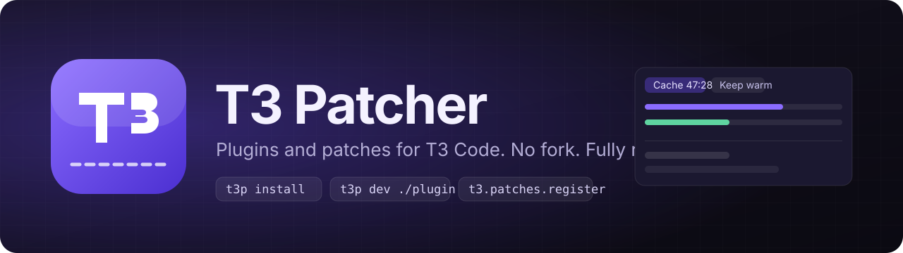</p>

> Building a plugin or patching the app? Start with [AGENTS.md](AGENTS.md) and [docs/plugin-authoring.md](docs/plugin-authoring.md). Not affiliated with the T3 Code project.

# T3 Patcher

T3 Patcher is a mod loader and patcher for the T3 Code desktop application. It injects a runtime and plugin system into the stock installed application without requiring a fork, allowing plugins, UI modifications, and custom integrations to persist across application restarts.

## Screenshots

Stock T3 Code 0.1.10 with the six first-party plugins loaded. Dark theme unless noted.

| | |
|---|---|
| 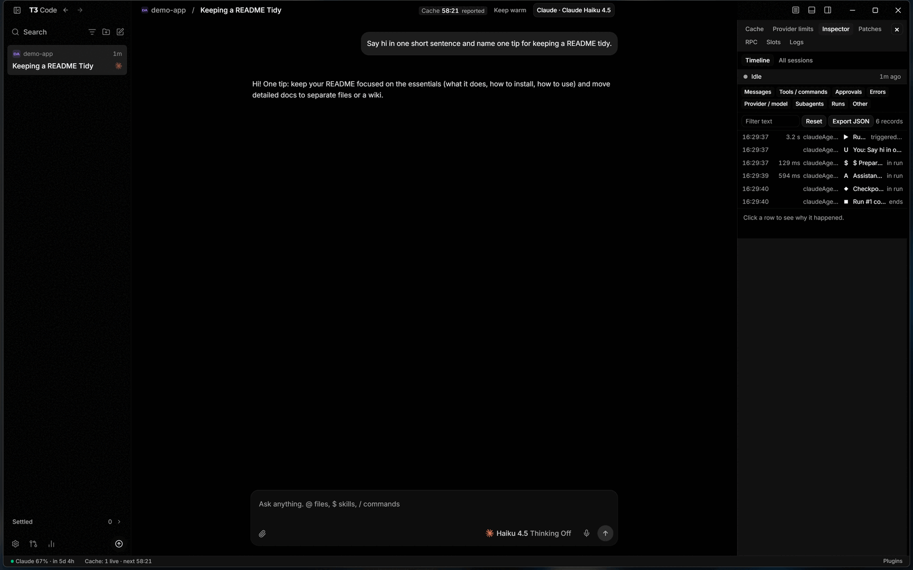<br>**Overview.** Cache timer, Keep warm and provider switcher in the thread header, limits and cache chips in the status bar, Inspector in the plugin dock. | 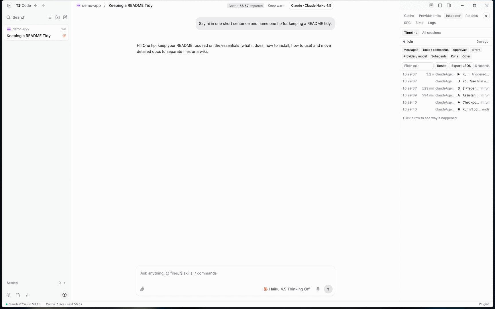<br>**Light theme.** Plugin UI reads the app's CSS variables, so every theme works with no extra code. |
| 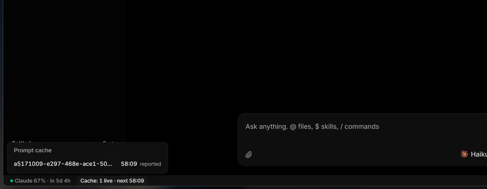<br>**Cache popover.** Click the status bar chip to see each live thread's prompt-cache countdown. | 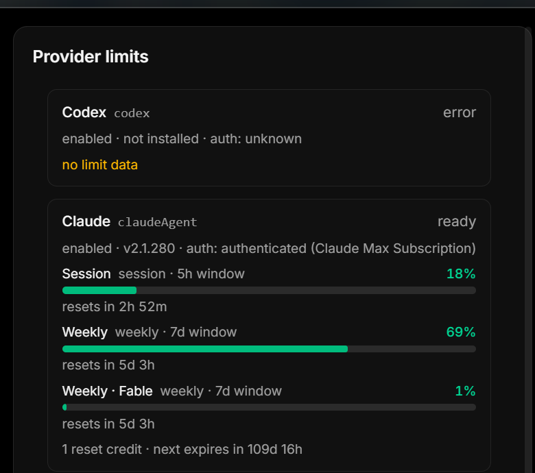<br>**Provider limits.** Session and weekly usage per provider, opened from the status bar chip (Claude shown; Codex had no data on the capture machine). |
| 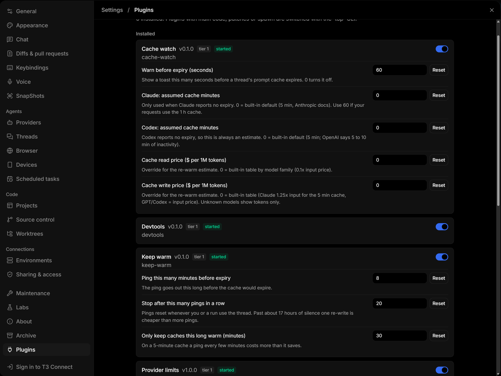<br>**Plugins settings.** Settings > Plugins (last entry in the Settings sidebar, under Archive): enable, disable and configure each plugin. | 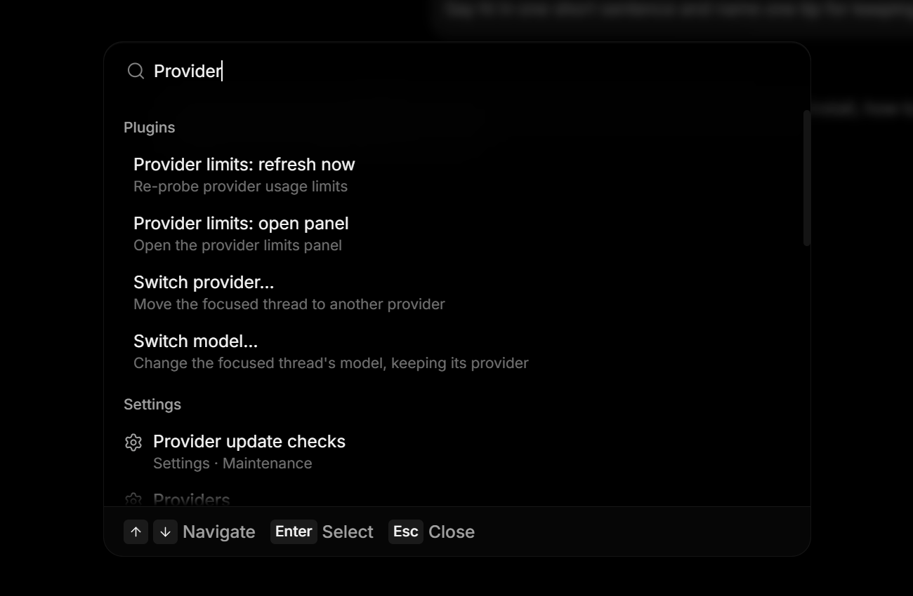<br>**Command palette.** Plugins register their own commands. |
| 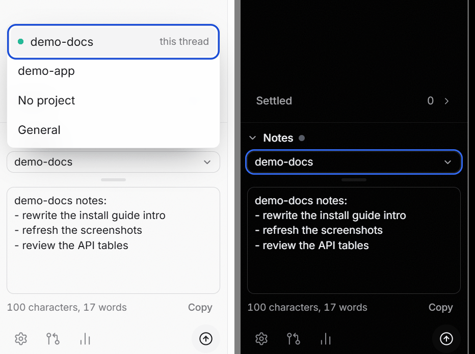<br>**Notes.** A per-project note above the sidebar footer: dropdown of projects (the thread's own marked), autosaving text area. Light with the dropdown open, dark closed. | |

## Overview

T3 Code is an Electron-based desktop application. T3 Patcher uses a non-destructive layout modification:

- The stock `resources/app.asar` is renamed to `resources/_app.asar`.
- A lightweight replacement `resources/app.asar` (approximately 6 KB) acts as a fail-open bootstrap shim.
- If native dependencies exist in `resources/app.asar.unpacked`, a directory junction `resources/_app.asar.unpacked` points to `resources/app.asar.unpacked`.
- The patcher runtime itself lives outside the application directory at `<T3P_HOME>/.t3-patcher/runtime/` (defaulting to `%USERPROFILE%/.t3-patcher/` on Windows).
- Stock files are never modified in place, and the executable's Authenticode digital signature remains valid.

## Installation

T3 Patcher supports Windows and T3 Code **0.1.10** (stable, Beta or Nightly channel). Two ways to install; pick one.

### Option 1: download `t3p.exe` (recommended, no Node needed)

1. Download `t3p.exe` from the [latest release](../../releases/latest) and save it anywhere (Downloads is fine).
2. **Close T3 Code**, then double-click `t3p.exe`. Windows SmartScreen may say "Windows protected your PC": the file is not code-signed yet, so click **More info**, then **Run anyway**. (Optional check: `certutil -hashfile t3p.exe SHA256` must match the `t3p.exe.sha256` file next to it.)
3. A console window opens and shows your T3 Code version, whether it is compatible, and the patcher status. Type `1` (Install) and press Enter. When it says "Done", press Enter to close the window and start T3 Code as usual. Plugins now load with it; manage them in **Settings > Plugins**.

The same exe is the command line tool: open a terminal and run `t3p.exe status`, `t3p.exe doctor`, and so on (see [CLI reference](#cli-reference)).

### Option 2: npm (needs Node 22 or newer)

```sh
npx t3p install          # one-off
# or install the command once:
npm i -g t3p
t3p install
```

Close T3 Code first. `t3p status` shows whether the patcher is active.

### Uninstall

Close T3 Code, run `t3p.exe` (or `t3p`) and choose **Uninstall**, or from a terminal `t3p uninstall`. The original T3 Code is restored exactly as it was. Your plugins and settings stay in `%USERPROFILE%\.t3-patcher`; `t3p uninstall --purge` also deletes the runtime files, and deleting that folder removes everything.

### Update

- **T3 Code updates:** nothing to do. The patcher puts itself back after an app update (a background worker, plus a repair task at logon). If it did not, run `t3p repair` or choose **Repair** in the menu. See [Updating and survival](docs/updating.md).
- **T3 Patcher updates:** download the newer `t3p.exe` (or `npm i -g t3p@latest`), close T3 Code, then run `t3p install` again or choose **Update** in the menu (no Uninstall needed). It refreshes the runtime and says `Updated runtime X -> Y` or `Already up to date`. Your plugins and settings are kept.
- A T3 Code version newer than 0.1.10 is refused until the patcher is updated for it. `--force` overrides that at your own risk.

### Safe mode / if something breaks

- **App will not start right, or a plugin misbehaves:** run `t3p.exe`, choose **Safe mode**, then start T3 Code. It opens once with no plugins and no patches. (Terminal: `t3p safe`; also `T3P_SAFE=1` or `--t3p-safe` on the app command line.)
- **Health check:** `t3p doctor` lists what is wrong. The patcher fails open: a broken runtime makes T3 Code start stock instead of not starting.
- **Back to stock:** **Uninstall** (above). If T3 Code itself is damaged, reinstall T3 Code; the patcher cannot make that worse because it never edits the app's files in place.

## CLI reference

The `t3p` command-line interface manages installation, health checks, updates, and plugins. Double-clicking `t3p.exe` opens the guided menu; running it in a terminal with no arguments prints this help.

```
Usage:
  t3p install   [--path DIR] [--force] [--runtime DIR] [--worker-node auto|copy|skip] [--json]
  t3p uninstall [--path DIR] [--purge] [--json]
  t3p status    [--path DIR] [--json]
  t3p doctor    [--path DIR] [--json]
  t3p repair    [--path DIR] [--if-stale] [--force] [--runtime DIR] [--worker-node auto|copy|skip] [--json]
  t3p plugins   [--json]
  t3p grant     <id> <permission> [--root DIR]... [--allow EXE]...
  t3p revoke    <id> <permission>
  t3p enable    <id>
  t3p disable   <id>
  t3p dev       <plugin-folder> [--json]
  t3p dev       --unlink <id> [--json]
  t3p safe      [--off]
```

### Commands

#### `t3p install`

Installs the patcher into a detected or specified T3 Code installation.

- Auto-detects the install directory from standard Windows locations (`%LOCALAPPDATA%\Programs\T3 Code`, `T3 Code (Beta)`, `T3 Code (Nightly)`).
- Validates Electron fuses (`runAsNode` must be enabled; `embeddedAsarIntegrityValidation` and `onlyLoadAppFromAsar` must be disabled).
- Verifies that the installed version matches supported versions (use `--force` to bypass version or fuse checks).
- Replaces `app.asar` with the shim, renames the original to `_app.asar`, creates the `_app.asar.unpacked` junction if needed, and writes an installation manifest to `<T3P_HOME>/.t3-patcher/manifest.json`.
- On an already patched app it refreshes `<T3P_HOME>/.t3-patcher/runtime` (staged, swapped by rename, rolled back on failure) and rewrites the shim only if it changed; prints `Updated runtime X -> Y` or `Already up to date`. Refuses while T3 Code is running. See [Updating and survival](docs/updating.md).
- `--worker-node auto|copy|skip`: Controls copying the app executable to `<T3P_HOME>/.t3-patcher/bin/t3p-node.exe` for the update repair worker. `auto` only copies if no system `node.exe` is found on `PATH`.

#### `t3p uninstall`

Restores the application to stock state.

- Validates `_app.asar` against recorded manifest hashes.
- Removes the replacement `app.asar` and the junction.
- Restores `_app.asar` back to `app.asar`.
- Removes the install record from `manifest.json`.
- `--purge`: In addition to restoring the application, deletes `<T3P_HOME>/.t3-patcher/runtime` and `<T3P_HOME>/.t3-patcher/bin`.

#### `t3p status`

Inspects and reports the installation state.

- Layout states:
  - `patched`: Correctly patched and verified against manifest hashes.
  - `unpatched`: Stock install, no patcher layout present.
  - `stale`: Upstream updater replaced `app.asar` with a stock version while patcher manifest remains.
  - `broken`: Partial or mismatched state (missing `_app.asar`, hash mismatch, or invalid junction).
  - `unknown`: No T3 Code installation found.
- Exit code: 0 if `patched` or `unpatched`, 1 if `stale`, `broken`, or `unknown`.

#### `t3p doctor`

Performs an end-to-end health check of the environment and patcher runtime:

1. Installation discovery and channel detection.
2. Electron fuse safety checks.
3. Upstream version compatibility.
4. Layout integrity (`app.asar`, `_app.asar`, and junction targets).
5. Hash verification against manifest.
6. Runtime file presence (`main.cjs`).
7. Windows Authenticode signature verification of the main executable.
8. Plugins the crash-loop guard disabled (see below). This is a warning only (exit code unaffected) until you re-enable them.
8. Tier 2 internal capture states (`atomRegistry`, `router`, `shortcutDispatcher`, `settingsNav`, `commandPalette`).
9. Recent entries in `shim.log`.

Exit code: 0 if all checks pass, 1 if any check fails.

#### `t3p repair`

Re-applies the patcher layout after an upstream application update.

- `--if-stale`: Only repairs if `t3p status` reports `stale`. If already patched or unpatched, exits cleanly without modifying files.
- Automatically re-detects executable names across channels (e.g. Beta to Nightly transitions).

#### `t3p safe`

Controls safe mode for emergency troubleshooting.

- `t3p safe`: Writes `<T3P_HOME>/.t3-patcher/safe-mode`. The next launch starts the stock app directly without loading any plugins, patches, or preloads, consuming the marker.
- `t3p safe --off`: Removes a pending safe-mode marker.
- Safe mode can also be triggered via environment variable `T3P_SAFE=1` or command-line switch `--t3p-safe`.

## Plugin Installation and Management

Plugins reside in `<T3P_HOME>/.t3-patcher/plugins/<id>/` and contain a `plugin.json` manifest and compiled JavaScript assets.

### Managing Plugins

List installed plugins, their status, declared permissions, and granted permissions:

```sh
t3p plugins
```

Enable or disable an installed plugin:

```sh
t3p enable <id>
t3p disable <id>
```

`t3p enable` also clears a crash-loop disable: the plugin's failure counter in `~/.t3-patcher/health.json` and the `disabledReason` in `state.json`. `t3p plugins` shows `(disabled: crash-loop; re-enable with: t3p enable <id>)` for such plugins.

**Crash-loop guard.** A plugin that fails to start 3 times in a row across launches is disabled automatically and T3 Code shows a toast on the next load. `T3P_CRASH_LOOP_THRESHOLD` changes the count. It never disables anything in dev mode. Details: `docs/security.md` section 7.1.

Grant or revoke permissions:

```sh
t3p grant <id> <permission> [--root DIR]... [--allow EXE]...
t3p revoke <id> <permission>
```

Link a local plugin development directory with live hot reloading:

```sh
t3p dev path/to/my-plugin
t3p dev --unlink <id>
```

For full details on user permissions and management commands, see [Plugin guide](docs/plugin-guide.md). For writing new plugins, see [Plugin authoring](docs/plugin-authoring.md).

## First-Party Plugins

T3 Patcher includes these first-party plugins located in the `plugins/` directory:

1. **`provider-limits`**:
   - Displays a status bar chip showing current AI provider usage and reset countdowns.
   - Provides a detailed drawer panel with percentage bars, reset credit status, and active limit windows for each provider instance.
   - Configurable warning threshold settings.

2. **`provider-switcher`**:
   - Adds a model selection badge to the thread header and command palette actions.
   - Enables switching model or provider for the current session.
   - Detects when an active run makes switching unavailable (`OrchestratorProviderSelectionBusyError`) and offers to queue the switch for run completion.
   - Provides optional rules to suggest least-used providers when approaching rate limits.

3. **`cache-watch`**:
   - Tracks prompt-cache TTL and countdowns per session in the sidebar and thread header.
   - Evaluates three data sources:
     - `reported`: Provider turn contains an exact `promptCacheExpiresAt` timestamp.
     - `carried`: Subsequent cache-hit turn without TTL reuses previous TTL from the newer request time.
     - `assumed`: Fallback estimate table for providers without explicit wire TTLs.
   - Lists sessions ordered by nearest expiration with optional advance warnings.

4. **`session-inspector`**:
   - Comprehensive timeline in the right panel displaying all thread activities, run durations, providers, and models.
   - Links causal chains (`in-run`, `triggered-by`, `approval-for`, `in-subagent`, `continues`).
   - All-sessions view showing live activity across every active thread.
   - JSON export functionality.

5. **`devtools`**:
   - Developer tooling panel with a chunk patch tester to evaluate search strings and regexes against live minified client chunks.
   - Interactive RPC console to issue queries and observe streaming subscriptions.
   - UI slot outline visualizer highlighting all available anchor points.
   - Live log viewer reading patcher and application log files via `t3.native.logTail`.

6. **`artwork`**:
   - Animated aurora, gradient, mesh glow or your own image behind the sidebar header, plus a custom logo text or image. Pure CSS, theme aware, no permissions.
   - Tune it live in the plugin dock: the **Artwork** tab has a preview-swatch preset grid, sliders, logo and saved-image controls that change the sidebar as you drag (command palette: Artwork: open panel). Also in Settings > Plugins.

   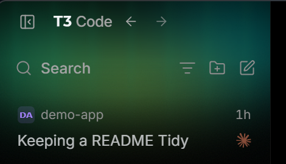 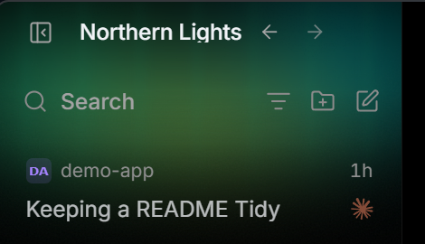 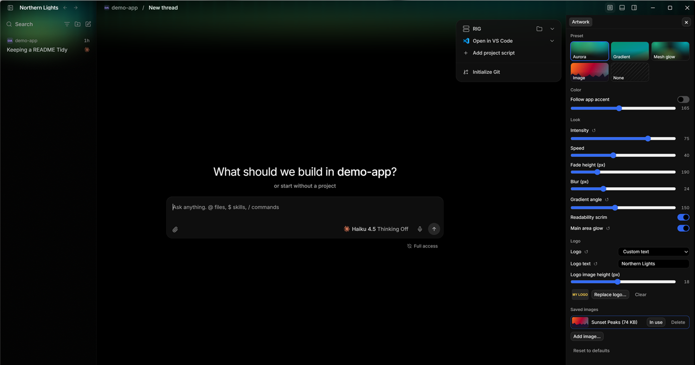

7. **`notes`**:
   - Quick plain-text notes in the sidebar, tied to the project of the thread you are in (plus a General note). Autosaves, remembers its height and collapsed state.
   - Dropdown to pick another project's note; opening another thread switches back to its project. Command palette: Notes: focus, toggle section, open General.
6. **`media`**:
   - Now-playing section in the thread details popover: cover, title, artist, previous / play-pause / next, progress. Reads the Windows system media session (Spotify, browsers, anything that shows in the Windows media overlay).
   - "Paste YouTube link" row and a command palette entry that play a video in a small embedded player, which can pop out to a draggable mini player above the status bar.
   - Optional status bar chip with the current title. Everything is off or on demand: nothing runs while no view needs it. See `plugins/media/README.md`.

## Safety Model

T3 Patcher adheres to strict stability and containment principles:

- **Fail-open bootstrap**: If the runtime directory is missing, or if `main.cjs` throws or fails to parse, the shim catches the error, logs it to `<T3P_HOME>/.t3-patcher/logs/shim.log`, and immediately launches the unmodified stock application (`_app.asar`).
- **Isolated execution**: Renderer plugins run within individual error boundaries. A throw in one plugin's `start()` method does not prevent other plugins from running.
- **Atomic patch validation**: Code replacements on client chunks are verified with an Acorn parser before serving. Any patch resulting in a JavaScript syntax error is rolled back to the original unmodified chunk and reported.
- **Security boundaries**:
  - Main-world execution: Renderer plugins execute in the main world of `t3code://app` and have access to the UI DOM and the bearer token.
  - Native permissions: Main-process capabilities (`fs.read`, `sqlite.read`, `log.tail`, `spawn`, `main`, `patches`) require explicit declaration in `plugin.json` and explicit user grants via `t3p grant`.
  - SQLite queries are executed in a dedicated forked utility process in read-only mode with query-only pragma and statement checks.
  - Process spawning requires exact allowlisted executable paths, disallows shell execution, hides windows, and scrubs environment variables.

For complete architectural details and threat analysis, see [Security model](docs/security.md).

## Support Policy

T3 Patcher targets a single supported upstream release of T3 Code at any given time.

- Supported upstream version: **`0.1.10`** (tag `v0.1.10`, commit `7d32075e3757ded707914e2450c3e392a9665765`).
- Electron version: `44.10.1`.
- The installer verifies version compatibility before applying modifications unless `--force` is supplied.
- When upstream releases a new version, the compatibility checker (`tools/compat`) evaluates patch match integrity, RPC contracts, and UI slot anchors before updating the supported version target.

For information on upstream version tracking and bump procedures, see [Upstream version](docs/upstream-version.md).

## Documentation Index

- [Plugin guide](docs/plugin-guide.md): User-facing plugin configuration, CLI commands, and permission management.
- [Plugin authoring](docs/plugin-authoring.md): Developer guide, plugin scaffolding, build preset, and manifest schema.
- [API reference](docs/api.md): Complete reference for the `t3` object generated from `@t3p/api`.
- [Patching mechanics](docs/patching.md): Stability tiers (1/2/3), text find-and-replace engine, and runtime captures.
- [Updating and survival](docs/updating.md): How patches survive upstream updates, background repair worker, and rollback.
- [Releasing](docs/release.md): Tagging a release, how `t3p.exe` is built, npm publish, checksum verification.
- [Security model](docs/security.md): Detailed threat model, IPC sender verification, and service sandboxing.
- [Upstream version](docs/upstream-version.md): Upstream commit tracking and version bump instructions.
