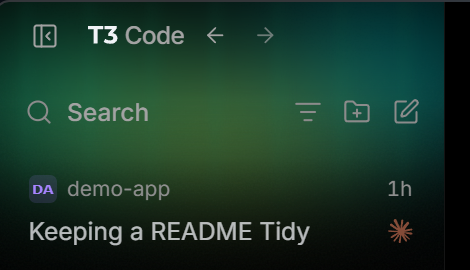
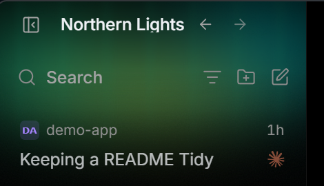
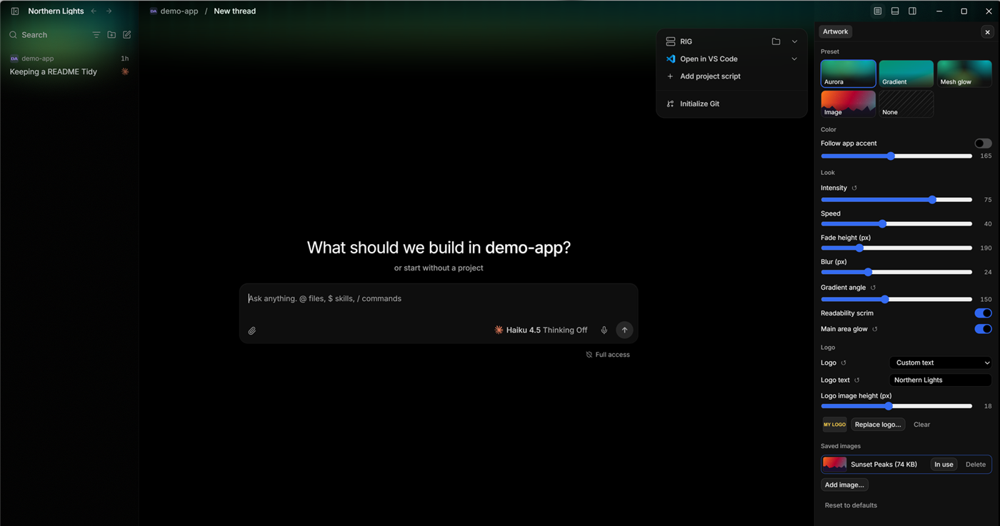

# artwork

Custom artwork behind the T3 Code sidebar header, plus a restyled logo. Tier 1, renderer only, **no permissions**.

  

## What it does

- **Backdrop** behind the title row, collapse button, arrows and Search row. Presets: **Aurora** (animated glow with faint rays), **Gradient** (angle), **Mesh glow**, **Image** (your own), **None**.
- **Ocean background** (off by default): a drifting field of letters behind the whole app, with click ripples. Separate from the sidebar preset, so it never replaces the aurora. See below.
- **Logo**: keep stock, custom text, custom image (height-fit), or hide the wordmark. Only the `T3 Code home` link's text/logo node is restyled; window controls, the collapse button and the back/forward arrows are never touched.
- **Main area glow** (off by default): a very faint same-style glow behind the top of the chat header.
- **Saved images**: pick a file (Settings > Plugins > Artwork images), it is downscaled to 1600 px, re-encoded as JPEG and saved by name. Switch by name there or with the command palette.

## Dock tab (live tuning)

Open the plugin dock (**Plugins** chip, bottom right, or command palette **Artwork: open panel**) and pick the **Artwork** tab. The dock does not cover the sidebar, so every change shows as you make it.



- **Preset grid**: Aurora, Gradient, Mesh glow, Image and None, each a small live render in the current colors.
- **Color**: *Follow app accent* switch, or a fixed hue slider.
- **Look**: intensity, speed, fade height, blur, gradient angle, readability scrim, main glow. Sliders update the sidebar while you drag and save shortly after (they come from the generic `t3.ui.settingsPanel` helper, see `docs/plugin-authoring.md`).
- **Logo**: keep / text / image / hide, text and height, and the logo image picker.
- **Saved images**: thumbnail, Use, Delete, Add image.
- **Reset to defaults** resets every artwork setting (saved images stay).

Everything goes through `t3.settings`, so Settings > Plugins stays in sync.

## Ocean background

Turn it on with the **Ocean background** switch (dock tab, section *Ocean background*, or Settings > Plugins > Artwork). Settings: on/off, **Ocean intensity**, **Ocean speed** (0 is a still frame), **Ocean ripples** (clicks and pointer glow). The glow follows the artwork Color setting (app accent by default); the letters use the app text color (`--foreground`), re-read every second, so dark, light and custom themes follow.

- A fixed full-viewport `<canvas id="t3p-ocean">` sits behind the app (`z-index:-1`, `pointer-events:none`). Pointer and click input are read from `window`, so the app never loses a click.
- The big opaque layers the app stacks over the page (body, the page wrappers) are made transparent while it runs; cards, menus and the composer keep their fills. The sidebar keeps its own background and the aurora.
- Pauses while the window is hidden, draws one still frame under `prefers-reduced-motion` or speed 0, and turning it off (or stopping the plugin) removes the canvas, style, listeners and animation frame.
- Code: `src/ocean.ts` (canvas engine), `src/model.ts` (`oceanParams`, `oceanPalette`), adapted from a user-supplied `ocean.js`.

## Switching

- Command palette: **Artwork: open panel**, **Artwork: switch preset** (choose), **Artwork: next preset** (cycle), **Artwork: switch image**.
- Settings > Plugins > Artwork: preset, intensity, speed, hue, fade height, blur, gradient angle, readability scrim, image name, main glow, logo mode, logo text, logo image height. Everything applies live, no reload.

## How it works

- The layer is an absolutely positioned, `pointer-events: none` div inserted as the first child of the sidebar's inner column (`[data-slot="sidebar-inner"]` first child, set to `isolation: isolate`) with `z-index: -1`, so all stock content stays above it, nothing shifts, and it copies the sidebar's corner radius. A `MutationObserver` re-attaches it if React re-renders.
- Colors are CSS only: the default accent is `var(--primary)` (hue-rotated with relative `oklch()` for the other glows), so dark, light and custom themes follow with no JS. Set Hue 0 to 360 to pin a color instead.
- A faint scrim made from `--sidebar` / `--background` sits under the title row so text stays readable on bright artwork (toggle: Readability scrim).
- Low CPU: transform-only animation, paused while the window is hidden, disabled for `prefers-reduced-motion` and when Speed is 0.

## Limits

- Plugin storage is 1 MiB, so a saved image gets `min(2 MB, space left)`. The encoder steps quality and size down to fit and shows an error toast if it still cannot.
- Only data URLs of png/jpeg/webp/gif made by the plugin are used as image sources.
- The logo node is attached to `a[aria-label="T3 Code home"]`. If a future T3 Code renames that label the logo options do nothing (the backdrop keeps working).

## Develop

```sh
pnpm --filter @t3p/artwork build
pnpm --filter @t3p/artwork test
```

Pure helpers (color math, preset to CSS variables, image sizing and byte budget, names) are in `src/model.ts` with tests.
