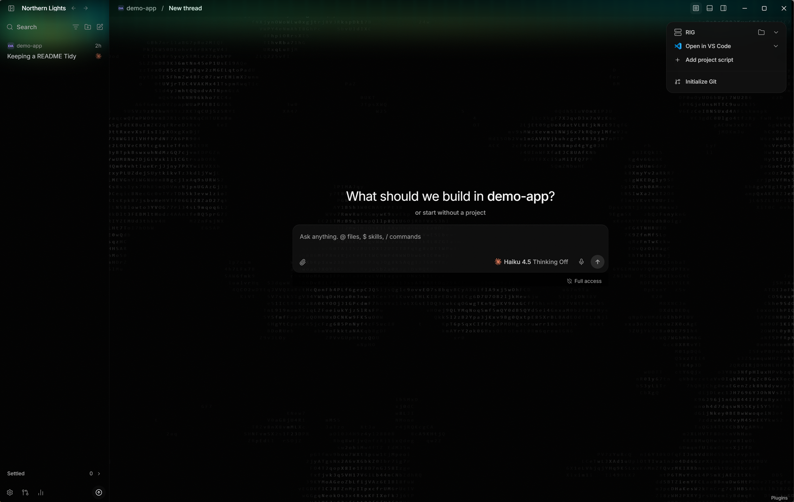
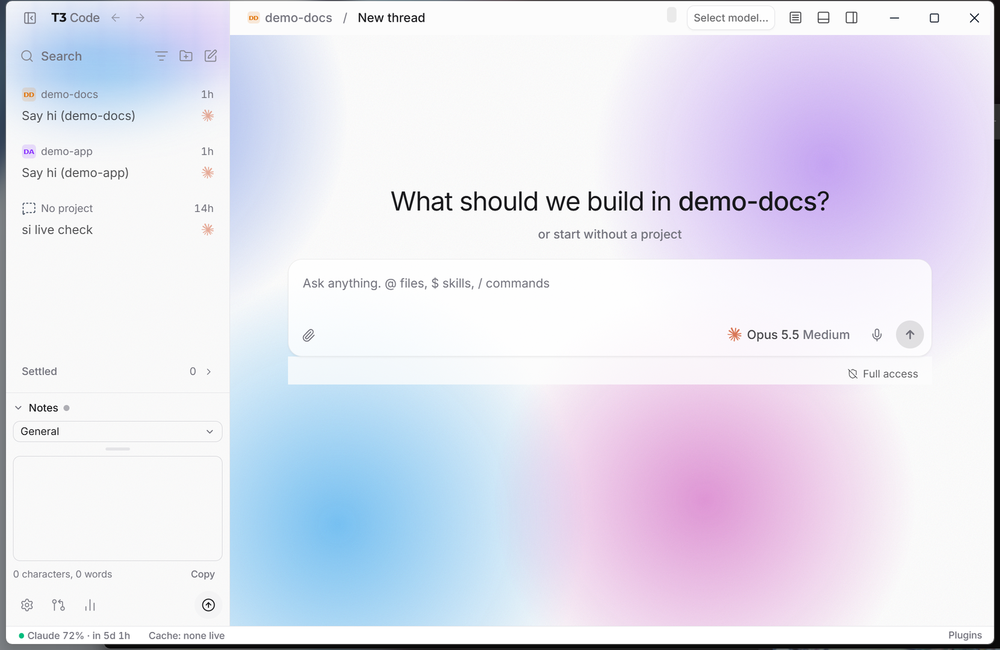
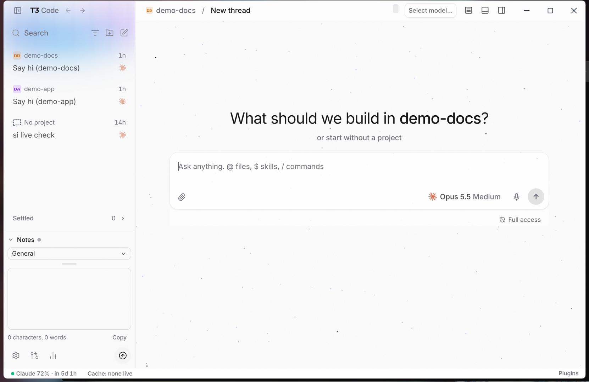
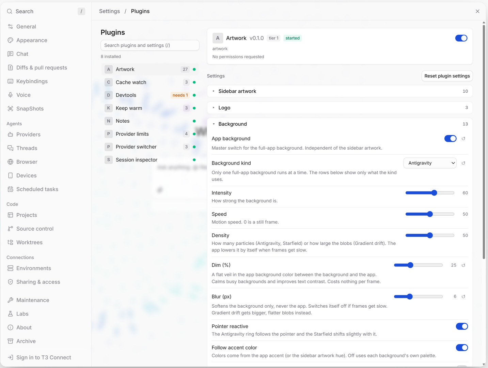
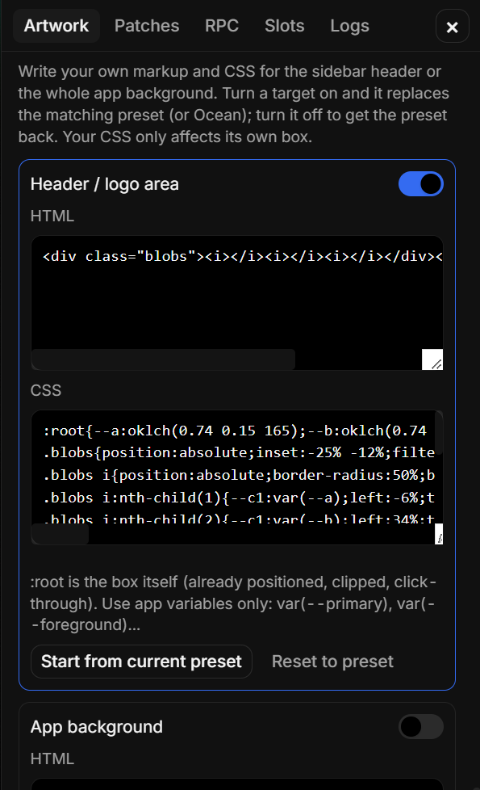

# artwork

Custom artwork behind the T3 Code sidebar header, plus a restyled logo. Tier 1, renderer only, **no permissions**.

  

## What it does

- **Backdrop** behind the title row, collapse button, arrows and Search row. Presets: **Aurora** (animated glow with faint rays), **Gradient** (angle), **Mesh glow**, **Image** (your own), **None**.
- **Background** (off by default): Ocean, Gradient drift or Starfield behind the whole app, one at a time, with dim and blur. One section, see below. Separate from the sidebar preset, so it never replaces the aurora.
- **Logo**: keep stock, custom text, custom image (height-fit), or hide the wordmark. Only the `T3 Code home` link's text/logo node is restyled; window controls, the collapse button and the back/forward arrows are never touched.
- **Main area glow** (off by default): a very faint same-style glow behind the top of the chat header.
- **Custom HTML/CSS** (off by default): write your own markup and CSS for the sidebar header or the whole app background instead of choosing a preset. See below.
- **Saved images**: pick a file (Settings > Plugins > Artwork images), it is downscaled to 1600 px, re-encoded as JPEG and saved by name. Switch by name there or with the command palette.

## Dock tab (live tuning)

Open the plugin dock (**Plugins** chip, bottom right, or command palette **Artwork: open panel**) and pick the **Artwork** tab. The dock does not cover the sidebar, so every change shows as you make it.


- **Preset grid**: Aurora, Gradient, Mesh glow, Image and None, each a small live render in the current colors.
- **Color**: *Follow app accent* switch, or a fixed hue slider.
- **Look**: intensity, speed, fade height, blur, gradient angle, readability scrim, main glow. Sliders update the sidebar while you drag and save shortly after (they come from the generic `t3.ui.settingsPanel` helper, see `docs/plugin-authoring.md`).
- **Logo**: keep / text / image / hide, text and height, and the logo image picker.
- **Saved images**: thumbnail, Use, Delete, Add image.
- **Custom HTML / CSS**: see below.
- **Reset to defaults** resets every artwork setting (saved images and your custom code stay).

Everything goes through `t3.settings`, so Settings > Plugins stays in sync.

## Ocean background

Pick **Ocean** in the **Background** section (dock tab, or Settings > Plugins > Artwork). Rows shown for Ocean: **Intensity**, **Speed** (0 is a still frame), **Ripples** (clicks and pointer glow). Keys unchanged: `oceanOn`, `oceanIntensity`, `oceanSpeed`, `oceanRipples`. The glow follows the artwork Color setting (app accent by default); the letters use the app text color (`--foreground`). A theme switch (class, style or `data-theme` on `<html>`, or the system color scheme) repaints at once, also while the background is frozen or static, so dark, light and custom themes follow.

- A fixed full-viewport `<canvas id="t3p-ocean">` sits behind the app (`z-index:-1`, `pointer-events:none`). Pointer and click input are read from `window`, so the app never loses a click.
- The big opaque layers the app stacks over the page (body, the page wrappers) are made transparent while it runs; cards, menus and the composer keep their fills. The sidebar keeps its own background and the aurora.
- Pauses while the window is hidden, draws one still frame under `prefers-reduced-motion` or speed 0, and turning it off (or stopping the plugin) removes the canvas, style, listeners and animation frame.
- Code: `src/ocean.ts` (canvas engine), `src/model.ts` (`oceanParams`, `oceanPalette`), adapted from a user-supplied `ocean.js`.

## App backgrounds (Ocean, Gradient drift, Starfield)

 

 Plugins" width="480">

Dock tab and Settings > Plugins, one section **Background** (order: Sidebar artwork, Logo, Background, Custom HTML/CSS). Rows depend on the kind (`showWhen`): Ocean extras only for Ocean, Density only where it applies. A radio row **Off / Ocean / Gradient drift / Starfield**. Only one runs at a time; the master switch is `oceanOn` ("App background") and the kind is `bgKind`. A Custom HTML/CSS background still takes over whichever one is on and gives it back when turned off.

| Setting | Meaning |
|---|---|
| `bgIntensity` | strength (alpha) |
| `bgSpeed` | motion speed, 0 is one still frame |
| `bgDensity` | particle / star count, blob size for Gradient drift |
| `bgPointer` | Starfield shifts slightly with the pointer (not used by Gradient drift) |
| `bgFollowAccent` | colors from the app accent / artwork Color; off uses the preset's own warm-to-cool palette |
| `bgLowPower` | cap Gradient drift and Starfield at 20 fps |
| `bgDim` | 0 to 80 %. One fixed compositor-only overlay between the background and the app UI, colour from `--background` |
| `bgBlur` | 0 to 20 px. Soften the background only (never the app UI) |
| `bgQuality` | **auto** (default) / high / balanced / low / static: frame rate and internal resolution. Auto starts at Balanced and steps down by itself when frames are late or the page has long tasks |
| `bgPauseWhileTyping` | default on: freeze on the current frame while you type or scroll and while the chat streams; resumes about a second later |

### Dim and blur

- **No `backdrop-filter` and no CSS `filter`.** Dim is a single `div#t3p-bg-dim` (`position:fixed`, `pointer-events:none`, `contain:strict`, opacity only). Blur is drawn **inside the canvas**: the preset draws into an offscreen canvas at a reduced resolution, and each drawn frame is blitted once to the visible canvas through `ctx.filter = blur()` (slightly oversized so the filter's edge bleed is off screen). A frozen (typing, streaming, hidden, still) background therefore costs nothing extra. Gradient drift bakes blur into its blobs (bigger, softer blobs on its small canvas), no blit at all. Why not a CSS filter: see `docs/artwork-perf.md` (WP-13D).
- Blur is shed automatically when frames run slow, once, before quality drops further: by the draw-cost governor (60-frame average over 10 ms) and by the Auto quality governor (a bad window sheds the blur first; the next bad window lowers the tier).
- Custom HTML/CSS background takes over dim and blur with the preset and gives them back. Reset all returns both to 0. Reduced motion keeps the still frame, dim and blur still apply.
- Measured on rig slot 2 (maximized 4K window, 120 Hz, typing + scrolling + streaming workload, `docs/artwork-perf.md`): with the old CSS filter blur 8 or 20 cost about +6 to +10 points of GPU process CPU while typing (up to +15 in the merge run) and pushed stream-to-frame p95 as high as 49.5 ms. With the in-canvas blur, blur 8 and 20 are within ~2 points of blur 0 while typing and idle on every preset, and stream-to-frame p95 is unchanged (about 29 to 35 ms, the same as no background). The cap stays 20 px.

All of them share the Ocean plumbing: a fixed full-viewport root at `z-index:-1`, `pointer-events:none`, input read from `window`, the big opaque app layers made transparent (`markSurfaces`), clean removal of root, style, attributes, timers and listeners on stop.

### Cost class

What a background costs the app is not its JavaScript (all draw well under 1 ms) but the frames it produces: each one makes the GPU process replay the canvas commands and re-composite the whole window, competing with the app's own frames. Measured on rig at 4K / 120 Hz, extra GPU process CPU over no background, idle (details and raw numbers: `docs/artwork-perf.md`):

| Preset | High | Balanced (Auto start) | Low | Static |
|---|---|---|---|---|
| Ocean (letters, 30/20/12 fps) | +10 | +9 | +7 | +1 |
| Gradient drift (4 blobs on a 0.2x canvas, 30/20/10 fps) | +6 | +4 | +3 | +1 |
| Starfield (dots, 30/20/12 fps) | +24 | +12 | +6 | +1 |

With the defaults (Auto, pause while typing) every preset costs the same as no background while you type, scroll or stream (stream-to-frame p95 31-32 ms vs 31 ms off).

### Performance rules

- Quality tiers (`src/bg-perf.ts`): frame rate plus internal resolution (px per CSS px, never above the device ratio) and a pixel budget (2.5 / 1.5 / 0.8 MP); the canvas is scaled up by CSS.
- Auto (`QualityGovernor`): every 3 s, average draw cost over 4 ms, more than 25 % of frames after a main-thread stall over 50 ms, or more than 150 ms of long-animation-frame blocking while animating, steps one tier down; 5 clean windows step back up, never above Balanced.
- Pause while typing (`ActivityGate`, one shared `ActivityMonitor`): key, wheel and scroll, or 12+ DOM mutation records a second (streaming), freeze the frame for 1.2 s / 1.5 s after the last one. Pointer moves and clicks do not. Mutations inside plugin UI (the dock, our own layers) never count, so an open dock cannot keep the background frozen.
- Fixed 1/60 s simulation step with dt clamped (a stall advances at most 100 ms), one draw per frame.
- Pauses at once while the document is hidden, and after the window has been blurred for more than 5 s. One still frame under `prefers-reduced-motion`, speed 0 or Static.
- Density fallback: above 10 ms average draw the density drops one step (60 %, then 35 %); still above 16 ms after a reduction, the background stops and a toast says so.
- One frame loop per background: a timer sleeps until the next frame is due, then one animation frame draws it (a 20 fps background wakes the page about 20 times a second, not at the display rate). Frames the browser throttles (minimized or covered window) never count against Auto.
- Sizing comes from a `ResizeObserver` on the canvas plus a device-pixel-ratio query; the canvas is resized and repainted inside the callback, so a resize or zoom never shows a blank frame.
- Surface checks run every 2 s and never while you are busy. Only fully opaque surfaces are made see-through (a modal backdrop or a translucent card keeps its fill).
- Measuring: set `window.__t3pBgPerf = []` before turning one on; every frame's draw cost (ms) is pushed into it. Whole-app measurements: `tools/rig/perf/`.

### Antigravity (removed)

Antigravity (round-capped dashes around a pointer ring) was dropped in WP-17. Its canvas raster alone cost about +22 points of GPU process CPU at Balanced on a 4K screen and 16 to 19 dropped frames a second whenever it animated, the same with the canvas hidden, so no compositing change could fix it (`docs/artwork-perf.md`). A saved `bgKind: "antigravity"` falls back to Ocean: the settings runtime returns the default for an enum value that is no longer an option.

## Custom HTML/CSS



Dock tab, section **Custom HTML / CSS**. Two targets, each with an enable switch, an HTML editor and a CSS editor (monospace, resizable):

| Target | Where it lives | While on it replaces |
|---|---|---|
| **Header / logo area** | absolute layer at the top of the sidebar column, behind the title row (`z-index:-1`) | the sidebar preset (Aurora, Gradient, Mesh, Image) |
| **App background** | fixed full-window layer behind the app, same slot as the app backgrounds | the active app background (Ocean, Gradient drift or Starfield; it comes back when you turn Custom off) |

- **Start from current preset** fills the editors with the active preset's generated markup and CSS (the background gets the same glow scaled to the window; the Ocean canvas cannot be exported as markup). Turning a target on with empty editors does this for you. **Reset to preset** asks, clears the editors and turns the target off, so the stock preset shows again.
- **Live preview**: typing applies after 250 ms. Invalid input is never applied: errors show under the editors with line numbers and the last good version stays on screen.
- In your CSS, `:root` (also `html`, `body`) is the container itself, already positioned, clipped and click-through. Everything else is prefixed with the container selector, so it cannot reach the dock, Settings or the app. `@media`, `@supports`, `@container`, `@layer` and `@keyframes` work (keyframe names are prefixed). Use app variables only (`var(--primary)`, `var(--foreground)`...): a hard-coded color shows a warning.
- Containment: the root has `pointer-events:none`, `overflow:hidden`, `isolation:isolate` and `contain:layout paint style`, protected from your CSS. Animations pause while the window is hidden and stop under reduced motion.

### Safety rules

- **HTML** is parsed with `DOMParser` and cleaned: `script, iframe, frame, object, embed, link, meta, base, form, input, button, textarea, select, style, template, canvas, audio, video` and svg `animate`/`set` are removed, as are every `on*` and `data-*` attribute, `srcset`, `name`, `tabindex` and similar. `href` keeps only `#fragment`; `src` keeps only `data:image/(png|jpeg|webp|gif|svg+xml)` (never `data:text/html` or `javascript:`). An inline `style` must pass the CSS rules or it is dropped. What was removed is listed as a warning. Ids are kept (SVG gradients need them), so pick unusual ones.
- **CSS** is rejected (with the reason) when it has `@import`, `@font-face`, `@namespace`, `@property`, `!important`, backslash escapes outside strings, `image-set()`/`src()`/`paint()`, `expression()`, `javascript:`, or a `url()` that is not `data:image/...` or `#fragment`. Limits: 40,000 characters of CSS and 20,000 of HTML per target.
- **Remote assets**: `http(s)://` urls in CSS and `` are blocked unless **Allow remote assets** (setting `allowRemoteAssets`, default off) is on. Remote files can track you and can change after you checked them.

### Storage, export and import

- The bundle is saved as one JSON value (`custom`) in the plugin storage, shortly after you stop typing. Storage is 1 MiB for the whole plugin, shared with saved images. The section shows how much the bundle uses; if a save would not fit, the editors keep working for this session, an error says "Not saved", and nothing is overwritten.
- **Copy bundle** puts `{"v":1,"header":{enabled,html,css},"background":{...}}` on the clipboard (if the clipboard is blocked, it opens in the paste box instead). **Paste bundle...** imports one: invalid JSON, a wrong version or oversized fields are refused and nothing changes; valid ones go through the same sanitizing as typed code.
- Turning a target off, or stopping/disabling the plugin, removes every node, style, attribute, timer and listener it added. The Ocean and the sidebar presets are never modified: Custom only hides them while it is on and valid.

## Switching

- Command palette: **Artwork: open panel**, **Artwork: switch preset** (choose), **Artwork: next preset** (cycle), **Artwork: switch image**.
- Settings > Plugins > Artwork: preset, intensity, speed, hue, fade height, blur, gradient angle, readability scrim, image name, main glow, logo mode, logo text, logo image height. Everything applies live, no reload.

## How it works

- The layer is an absolutely positioned, `pointer-events: none` div inserted as the first child of the sidebar's inner column (`[data-slot="sidebar-inner"]` first child, set to `isolation: isolate`) with `z-index: -1`, so all stock content stays above it, nothing shifts, and it copies the sidebar's corner radius. A `MutationObserver` re-attaches it if React re-renders.
- Colors are CSS only: the default accent is `var(--primary)` (hue-rotated with relative `oklch()` for the other glows), so dark, light and custom themes follow with no JS. Set Hue 0 to 360 to pin a color instead.
- A faint scrim made from `--sidebar` / `--background` sits under the title row so text stays readable on bright artwork (toggle: Readability scrim).
- Low CPU: transform-only animation, paused while the window is hidden, disabled for `prefers-reduced-motion` and when Speed is 0.

## Limits

- Plugin storage is 1 MiB, so a saved image gets `min(2 MB, space left)`. The encoder steps quality and size down to fit and shows an error toast if it still cannot.
- Only data URLs of png/jpeg/webp/gif made by the plugin are used as image sources.
- The logo node is attached to `a[aria-label="T3 Code home"]`. If a future T3 Code renames that label the logo options do nothing (the backdrop keeps working).

## Develop

```sh
pnpm --filter @t3p/artwork build
pnpm --filter @t3p/artwork test
```

Pure helpers (color math, preset to CSS variables, image sizing and byte budget, names) are in `src/model.ts` with tests. Custom mode: `src/custom-css.ts` (scoping and CSS rules), `src/custom-html.ts` (sanitizer), `src/custom.ts` (roots, apply and dispose), `src/custom-templates.ts` (preset to markup), `src/custom-panel.ts` (editors); tests in `test/custom*.test.ts`.
