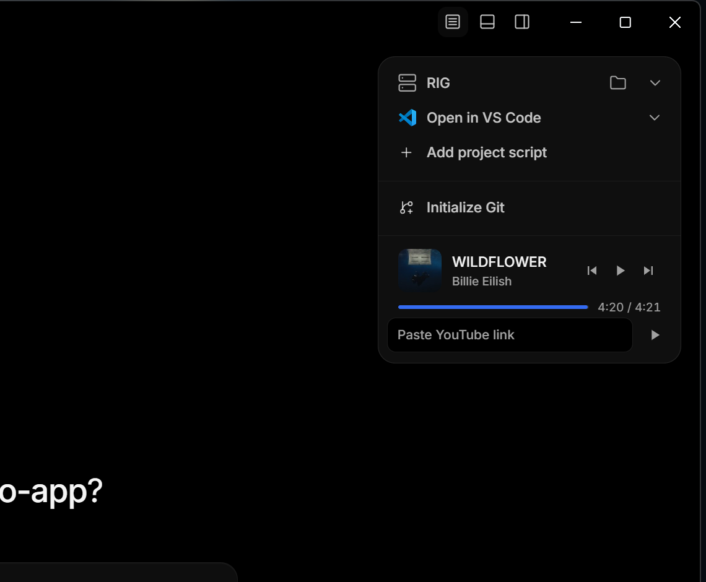

# media

Now playing and a YouTube player, inside T3 Code's thread details popover (the card with environment, branch, limits and context).



## What it does

- **Now playing.** Cover, title, artist, previous / play-pause / next, progress bar and time. It reads the Windows system media session (SMTC), so it shows whatever you play in Spotify, a browser, etc. Empty state: "Nothing playing".
- **Paste YouTube link.** Accepts `youtu.be/<id>`, `youtube.com/watch?v=`, `/shorts/`, `/embed/`, `/live/` and `/playlist?list=` (also `music.youtube.com`). Anything else is refused by a strict parser (host allow list, 11-character id pattern, no credentials or ports). The video plays in a 16:9 `youtube-nocookie.com` embed with a close button and a thumbnail (`i.ytimg.com`, loaded only after you paste a link).
- **Pop out.** The embed can float as a draggable mini player above the status bar and keeps playing after the popover closes. Closing the popover while the embed is inline stops it (it resumes where it was when you reopen).
- **Command palette:** "Media: play YouTube link" opens a mini player directly.
- **Status bar chip** (setting `statusChip`, off by default): the current title with ellipsis, click to play/pause.
- **Recent links** (setting `rememberLinks`, off by default): keeps the last 5 links and asks YouTube's oEmbed for their titles. With it off the plugin makes no network request except the embed and its thumbnail.

## Permissions

```json
["main", { "spawn": { "allow": ["C:/Windows/System32/WindowsPowerShell/v1.0/powershell.exe", "~/.t3-patcher/plugins/media/smtc.ps1"] } }]
```

It has a `main` entry (`main.cjs`), so it is trusted code: enable and grant it yourself.

```sh
t3p enable media
t3p grant media main
t3p grant media spawn
```

The helper `smtc.ps1` runs in one long-lived hidden PowerShell process through `ctx.native.spawnSession`, which only accepts `-File` with the granted script (see docs/security.md 5.4). It is read-only except for the three transport commands, does not touch the network or disk, and exits when its stdin closes.

## When does anything run?

Nothing, until a view asks. The renderer polls only while the popover section is open (every second) or while the chip is on (every 5 seconds). The main side starts PowerShell on the first poll and stops it 15 seconds after the last one. If SMTC cannot start, it backs off from 5 seconds up to 5 minutes.

## Permission `embed.youtube` (needed for playback)

The app origin is `t3code://app`, which is not http(s), so the embed request carries no Referer and YouTube answers "Video player configuration error 153". With the `embed.youtube` permission the main process sets `Referer: https://www.youtube-nocookie.com/` on **one** request: the frame navigation to `https://www.youtube-nocookie.com/embed/*`. No other host or header is touched, and it stops as soon as the plugin is disabled or the grant is revoked. Grant it once:

```sh
t3p grant media embed.youtube
```

Measured on rig (slot 2, stock 0.1.10, Big Buck Bunny): with the grant the player reaches state 1 (playing); without it YouTube returns error 153. Without the grant the embed shows YouTube's error (the thumbnail, link parsing, pop-out and recent list still work). Details: docs/security.md (permissions table).

## YouTube and T3's CSP

T3's `frame-src` already allows `https:` frames, so no CSP change is needed (docs/security.md section 6). The IFrame API script is blocked by `script-src`, so play/pause and position tracking use the embed's `postMessage` channel.

## Develop

```sh
pnpm --filter @t3p/media build
pnpm --filter @t3p/media test
```

Pure helpers with tests: `src/youtube.ts` (parsing, embed URLs, player messages), `src/smtc.ts` (poll validation, progress math), `main-service.cjs` (demand-driven helper lifecycle).
