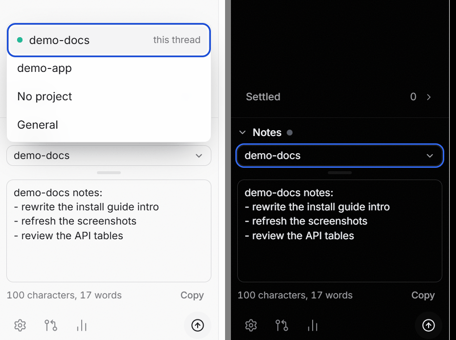

# notes

Quick plain-text notes tied to the **project** of the thread you are in. Tier 1, renderer only, permission `rpc`.

- A **Notes** section sits above the sidebar footer (outside the scrolling thread list, so it stays in view). Click the header to collapse it. A grey dot means saved, amber means saving.
- The dropdown shows the current project. Opening it lists every project (the one of the current thread marked **this thread**) and **General**, a note that belongs to no project. Picking one pins it until you open another thread, then the panel follows that thread's project again.
- Drag the grip above the text area to resize it. Collapsed state and height are remembered.
- Autosave 400 ms after you stop typing, on blur and when the page unloads. Switching notes or threads writes the pending text first, so nothing is lost. An empty note is deleted from storage.
- **Copy** puts the note on the clipboard. The tooltip and the footer show characters and words.
- Command palette: **Notes: focus**, **Notes: toggle section**, **Notes: open General**.

## How the project is found

The plugin reads the shell stream (`t3.rpc.subscribe("orchestration.subscribeShell")`): projects (`id`, `title`, `workspaceRoot`) and each thread's `projectId`, plus `t3.threads.list()` for a thread that has not appeared in the stream yet. The focused thread comes from `t3.threads.current()` (not the slot context, which follows the captured router and can lag a hash change). A thread without a project shows **General**; a thread whose project is not in the list shows its note under "Unknown project".

Notes are stored per plugin in `t3.storage`: `notes:<projectId>`, `notes:@general`, and `ui` (collapsed, height).

## Not included

- **Send to composer**: the public API has no way to insert text into the composer (`t3.ui` slots only mount around it, `composerBanner`), so there is no such button.
- Markdown rendering, per-thread notes.

## Layout

- `src/model.ts`: storage keys, project resolution, menu rows, the debounce/save state machine (`Autosaver`). Pure, tested in `test/model.test.ts`.
- `src/index.ts`: DOM, shell stream, commands.
